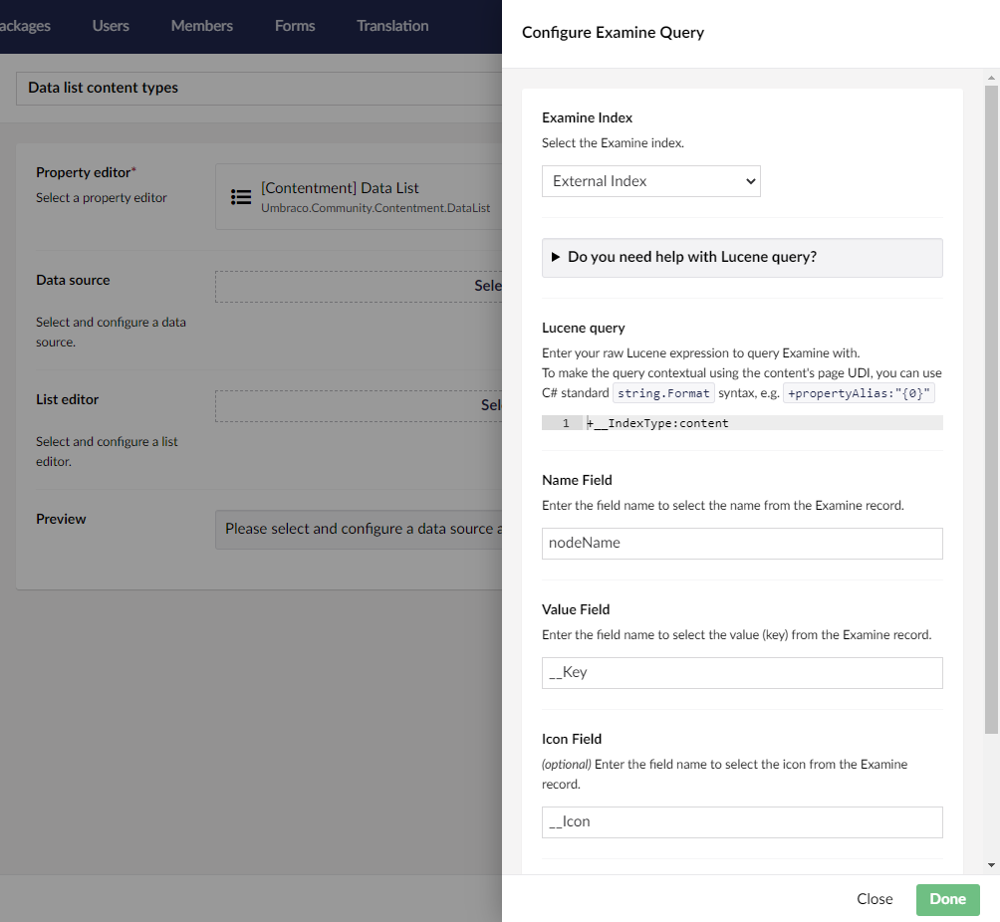

## Contentment for Umbraco

### Data Sources

#### Examine Query

Populate the data source from an Examine query.

##### How to configure the data-source?

First select the Examine index containing the values you need in your Data Source. Then you need to enter the raw Lucene expression to query Examine with. To make the query contextual using the content's page UDI, you can use C# standard `string.Format` syntax, e.g. `+propertyAlias:"{0}"`

Enter the field name to select the name, and the field name to select the value (key) from the Examine record.

Optionally, you can enter the field name to select the icon, and the field name to select the description from the Examine record.

##### Umbraco 19 and later

Umbraco 19 moved Examine into the optional `Umbraco.Cms.Search.Provider.Examine` package. This data source needs Examine to be installed (it is included in the `Umbraco.Cms` package); without it, the index list is empty and the data source returns no items. Contentment does not depend on Examine itself.

- **Indexes:** use the Umbraco index aliases, e.g. `Umb_PublishedContent` (published content), `Umb_Content` (all content, including unpublished), `Umb_Media`, `Umb_Members`.
- **Fields:** the field names follow the pattern `Field_{name}_{type}`, e.g. `Field_Umb_Name_keywords`, `Field_Umb_Id_keywords`, `Field_Umb_ParentId_keywords`, `Field_Umb_ContentTypeId_keywords` and `Field_Umb_ObjectType_keywords`. The type is `keywords` (exact match), `texts` or `textsr1` (analyzed text), `integers` or `datetimeoffsets`.
- **Cultures:** each culture of a content item is indexed as a separate document. The query is limited to the current culture (or the default culture) and invariant content, using the `Sys_Culture` field. If your query contains `Sys_Culture`, it is used as-is.
- **Icon:** the index no longer contains an icon. When the icon field is empty, the icon of the content type is used.
- **Zero-downtime indexing:** the active index is resolved automatically, so use the alias (without the `_a`/`_b` suffix).

###### Upgrading from earlier versions

Data Types saved with the earlier index and field names keep working. `ExternalIndex`, `InternalIndex` and `MembersIndex` are mapped to their `Umb_` aliases, `nodeName` and `__Key` are mapped to the new fields, and `__IndexType:content` (also `media` and `member`) is mapped to `Field_Umb_ObjectType_keywords`.

Any other field names used in your Lucene query are not mapped, (e.g. `id`, `parentID`, `path`, `templateID`, `urlName`), as they are not in the new index. Please update those queries to use the new field names.

##### What is the value's object-type?

The value returned from the List editor is an `string` containing the value of the field specified in the configuration.

Depending on the `List editor` used, this may be wrapped in a `List<string>`.